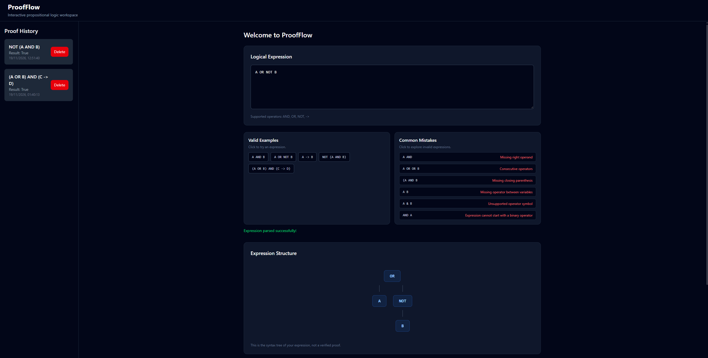
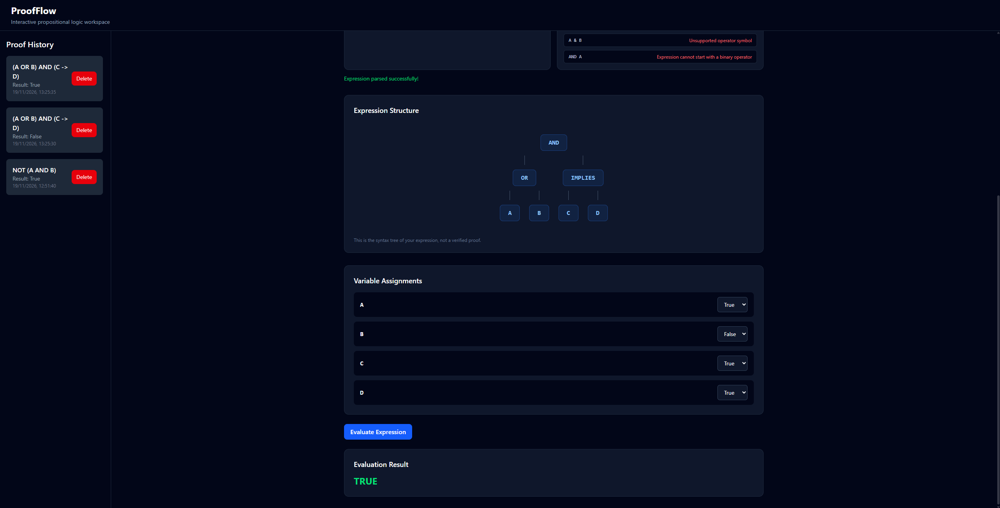
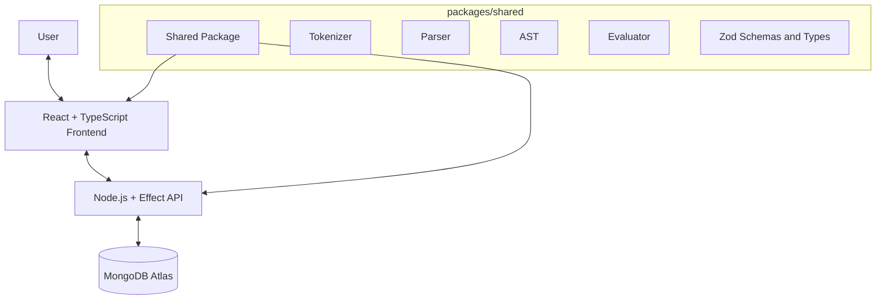

# ProofFlow

**An interactive propositional logic workspace built with React, TypeScript, Node.js, and Effect.**

ProofFlow allows users to write propositional logic expressions, explore their Abstract Syntax Trees (ASTs), assign Boolean values to variables, and evaluate expressions interactively. Evaluated expressions can also be saved and managed through a persistent backend.

**Live Demo:** https://proofflow-workspace.vercel.app/

**Repository:** https://github.com/SyedAzlanzar/proofflow

---

## Features

- **Logical Expression Editor:** Write expressions using `AND`, `OR`, `NOT`, and implication (`->`).
- **Tokenizer:** Converts the input expression into a sequence of tokens.
- **Recursive-Descent Parser:** Parses tokens into an AST while respecting operator precedence and associativity.
- **AST Visualization:** Explore the syntactic structure of logical expressions.
- **Variable Extraction:** Automatically identifies variables used in an expression.
- **Variable Assignments:** Assign `TRUE` or `FALSE` to individual variables.
- **Expression Evaluation:** Evaluates expressions based on the provided variable assignments.
- **Input Validation:** Detects malformed expressions and reports parsing errors.
- **Proof History:** View previously evaluated expressions.
- **Persistent Storage:** Save, retrieve, and delete evaluated expressions using MongoDB.

## Supported Logical Operators

| Operator | Meaning     | Example   |
| -------- | ----------- | --------- |
| `NOT`    | Negation    | `NOT A`   |
| `AND`    | Conjunction | `A AND B` |
| `OR`     | Disjunction | `A OR B`  |
| `->`     | Implication | `A -> B`  |

Operator precedence:

1. `NOT`
2. `AND`
3. `OR`
4. `IMPLIES`

Implication is right-associative.

## Screenshots

### Main Workspace



### Expression Evaluation and AST Visualization




## Architecture

ProofFlow is organized as an npm monorepo with separate frontend, backend, and shared packages.



The shared package contains the core logic and reusable types used by both the frontend and backend.

### Deployment

| Component   | Platform      |
| ----------- | ------------- |
| Frontend    | Vercel        |
| Backend API | Railway       |
| Database    | MongoDB Atlas |

## Technology Stack

**Frontend**

- React 19
- TypeScript
- Vite
- Tailwind CSS v4

**Backend**

- Node.js
- TypeScript
- Effect
- MongoDB

**Shared Package**

- TypeScript
- Zod
- Vitest

**Development and Testing**

- npm Workspaces
- Git
- Vitest

## Project Structure

```text
proofflow/
├── apps/
│   ├── web/                 # React frontend
│   └── api/                 # Node.js backend
│
├── packages/
│   └── shared/              # Shared logic and types
│       └── src/
│           ├── tokenizer/
│           ├── parser/
│           ├── evaluator/
│           └── ...
│
├── package.json
├── package-lock.json
├── tsconfig.base.json
└── README.md
```

## Getting Started

### Prerequisites

- Node.js 22 or later
- npm
- MongoDB connection string

### 1. Clone the repository

```bash
git clone https://github.com/SyedAzlanzar/proofflow.git
cd proofflow
```

### 2. Install dependencies

```bash
npm install
```

### 3. Configure environment variables

Configure the environment variables required by the frontend and backend.

Backend:

```env
MONGODB_URI=your_mongodb_connection_string
PORT=3000
```

Frontend:

```env
VITE_API_URL=http://localhost:3000
```

Do not commit environment files or expose database credentials.

### 4. Build the shared package

```bash
npm run build --workspace=@proofflow/shared
```

### 5. Start the frontend

```bash
npm run dev:web
```

### 6. Start the backend

In a separate terminal:

```bash
npm run dev:api
```

The frontend development server is usually available at `http://localhost:5173`.

## Building

Build the shared package and backend:

```bash
npm run build
```

Build the frontend after building the shared package:

```bash
npm run build --workspace=@proofflow/shared
npm run build --workspace=@proofflow/web
```

## Running Tests

Run the shared package tests:

```bash
npm run test --workspace=@proofflow/shared
```

Run the frontend tests:

```bash
npm run test --workspace=@proofflow/web
```

Run the backend tests:

```bash
npm run test --workspace=@proofflow/api
```

## API Endpoints

| Method   | Endpoint      | Description            |
| -------- | ------------- | ---------------------- |
| `GET`    | `/`           | API root               |
| `GET`    | `/health`     | Health check           |
| `POST`   | `/evaluate`   | Evaluate an expression |
| `GET`    | `/proofs`     | Retrieve saved proofs  |
| `GET`    | `/proofs/:id` | Retrieve a proof by ID |
| `DELETE` | `/proofs/:id` | Delete a saved proof   |

## Project Scope

ProofFlow currently focuses on propositional logic.

It provides expression parsing, AST construction and visualization, Boolean variable assignments, and expression evaluation.

**ProofFlow is not a formal theorem prover or a proof verification system.** It evaluates logical expressions for given variable assignments rather than automatically proving theorems.

## License

No license has currently been specified.
